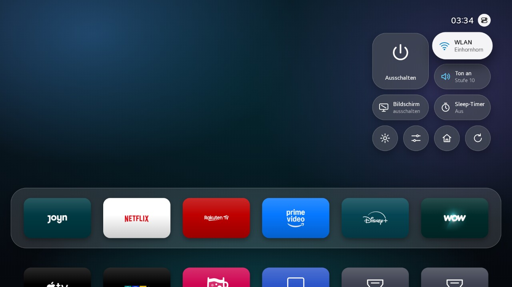

# Custom Launcher for webOS

A tvOS-style home screen for **rooted LG webOS TVs** with the [Homebrew Channel](https://github.com/webosbrew/webos-homebrew-channel). It can replace LG Home, so the Home button on the remote opens this launcher.


| App grid | Control center |
| --- | --- |
|  |  |

## Features

- **One grid, no categories**: six columns, as on tvOS. The first row is the dock and sits at the bottom of the screen over the wallpaper; moving down slides the grid up.
- **Everything in the same grid**: installed apps (from `luna://com.webos.applicationManager/listLaunchPoints`, with their original icons), Live TV, HDMI 1–4 (names and plug state come from the TV) and the system apps.
- **Re-orderable**: hold OK until the tile wiggles, move it with the arrow keys, press OK to drop it. The first six tiles form the dock. The order is saved.
- **Focus effect**: the tile grows, tilts in the direction of travel (with the Magic Remote it follows the pointer) and gets a highlight and a deep shadow; the background takes on the colour of the focused tile.
- **Wallpaper from the app**: if the focused app ships its own background image (`bgImage`, e.g. Netflix, Disney+), it fills the screen, similar to the tvOS top shelf. Apps do not expose what is currently playing, so the image they ship is all there is.
- **Control center**: press Up from the dock. A panel of glass tiles unfolds below the clock: power off, network, sound on/mute, screen off, sleep timer, launcher settings, TV settings, Home Dashboard and restart. Down or Back closes it.
- **Replace LG Home**: the Home button opens the launcher instead of the LG home screen, from any app.
- **Input**: arrow keys, OK, Back, Home; Magic Remote pointer, click, long click and wheel.
- No build step: plain HTML/CSS/JS, the IPK is about 35 kB.

## Requirements

- An LG TV running webOS, **rooted**, with the Homebrew Channel installed (tested on webOS 6.5.3).
- Root is needed because third-party apps may neither read the app list nor other apps' icons. The launcher uses the Homebrew Channel service `org.webosbrew.hbchannel.service/exec` for that.

## Installation

Download the IPK from the [releases](https://github.com/swenz/webos-custom-launcher/releases): `io.github.swenz.customlauncher_1.3.0_all.ipk`.

**Option A – webOS Dev Manager** ([download](https://github.com/webosbrew/dev-manager-desktop)): connect the TV, choose *Apps → Install* and pick the IPK.

**Option B – webOS CLI** (`npm i -g @webos-tools/cli`, set the TV up once with `ares-setup-device`):

```bash
ares-install -d <device> io.github.swenz.customlauncher_1.3.0_all.ipk
```

**Option C – on the TV itself** (SSH or telnet as root):

```bash
cd /tmp && wget -O cl.ipk https://github.com/swenz/webos-custom-launcher/releases/download/v1.3.0/io.github.swenz.customlauncher_1.3.0_all.ipk
luna-send -i -f luna://com.webos.appInstallService/dev/install '{"id":"io.github.swenz.customlauncher","ipkUrl":"/tmp/cl.ipk","subscribe":true}'
```

(Stop it with Ctrl+C once `"state": "installed"` appears.)

## Setup: Home button and opening at power-on

Open the launcher and choose **Launcher Settings** (the last tile in the grid, or the gear in the control center).

| Option | Effect |
| --- | --- |
| **Replace LG Home** | The Home button opens the launcher. Takes effect immediately and after every reboot. |
| **Open at power-on** | Toggles LG's *Home Auto Launch*. When it is on, the TV shows the home screen after power-on – with LG Home replaced, that is the launcher. |
| **Show system apps** | Shows or hides the preinstalled LG apps in the grid. |
| **Reset order** | Restores the default arrangement. |

### How replacing LG Home works

There is exactly one place where the launcher hooks in: the LG Home executable, `/usr/bin/com.webos.app.home`. The system starts it whenever the home screen should appear – on the Home button, on *Home Auto Launch* after power-on or wake-up, and when an app asks for the home screen.

- `boot-hook.sh` is copied to `/var/lib/webosbrew/init.d/50-customlauncher`. The Homebrew Channel startup script runs that file on every boot.
- The hook bind-mounts `home-stub.sh` over the LG Home executable. This small script registers with the application manager like the real Home and opens the launcher on every launch event.
- Nothing on the system partition is modified. The mount only exists in memory; without the hook, a reboot restores the original state.

### Apps added or removed

The list is read again every time the launcher comes to the front and every two minutes while it is showing. New apps appear at the end of the grid, removed apps disappear, and the saved order of all other tiles is kept.

### Uninstalling

Uninstall the app as usual. The stand-in script notices that the launcher is gone, releases the mount and deletes the boot hook and its folder; LG Home works again right away. Nothing is left outside the app's own folder.

To undo the replacement by hand:

```bash
/var/lib/webosbrew/init.d/50-customlauncher --stop
rm -rf /var/lib/webosbrew/init.d/50-customlauncher /var/lib/webosbrew/customlauncher
```

## Limitations

- While "Replace LG Home" is on, the LG home screen is not reachable. Turn the option off to get it back.
- Tested on one device (webOS 6.5.3). LG Home may be built differently on other webOS versions; in that case turn the option off or remove the hook as shown above.
- The Homebrew Channel service cannot handle parallel `exec` calls, so the launcher sends them strictly one after another.

## Building

```bash
npm i -g @webos-tools/cli
npm run build
```

This creates `dist/io.github.swenz.customlauncher_<version>_all.ipk` and updates the manifest. `npm run icons` regenerates the icons (Python with Pillow).

`tools/tvsh.py <tv-ip> '<command>'` runs a command through the Homebrew Channel's root telnet, for testing.

## webosbrew manifest

[`io.github.swenz.customlauncher.manifest.json`](io.github.swenz.customlauncher.manifest.json):

```json
{
  "id": "io.github.swenz.customlauncher",
  "version": "1.3.0",
  "type": "web",
  "title": "Custom Launcher",
  "appDescription": "Apple-TV-style home screen for rooted LG webOS TVs",
  "iconUri": "https://github.com/swenz/webos-custom-launcher/raw/main/app/largeIcon.png",
  "sourceUrl": "https://github.com/swenz/webos-custom-launcher",
  "rootRequired": true,
  "ipkUrl": "https://github.com/swenz/webos-custom-launcher/releases/download/v1.3.0/io.github.swenz.customlauncher_1.3.0_all.ipk",
  "ipkHash": {
    "sha256": "091b35c17f0f26a3ce260cfd8e9686fa6fb7b1fc90bbb9f8f7a6fe38e6260847"
  }
}
```

## License

[MIT](LICENSE). Not an official product of LG or Apple; app names and icons belong to their respective owners.
