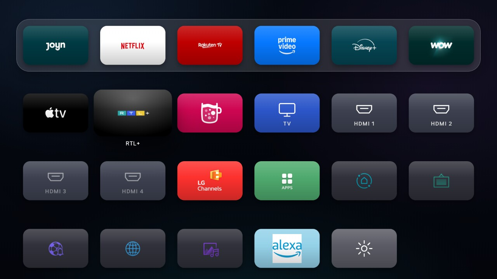
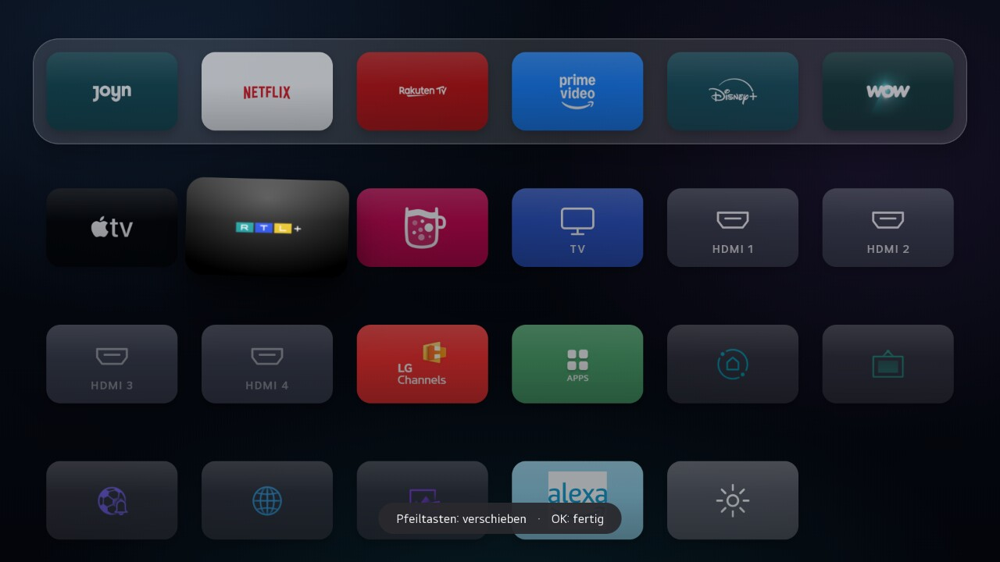

# Custom Launcher für webOS

Ein eigener Startbildschirm im Stil von tvOS für **gerootete LG-webOS-TVs** mit [Homebrew Channel](https://github.com/webosbrew/webos-homebrew-channel). Er ersetzt auf Wunsch das LG-Home: Die Home-Taste öffnet dann diesen Launcher.

*A tvOS-style home screen for rooted LG webOS TVs: app grid with a dock, focus zoom with parallax tilt, re-orderable tiles, D-pad and Magic Remote navigation. It can replace LG Home so the Home button opens the launcher.*


| Raster | Sortieren |
| --- | --- |
|  |  |

## Funktionen

- **Ein Raster, keine Kategorien**: sechs Spalten wie bei tvOS. Die erste Reihe ist das Dock und steht unten vor dem Hintergrund; geht man nach unten, schiebt sich das Raster nach oben.
- **Alles im selben Raster**: installierte Apps (aus `luna://com.webos.applicationManager/listLaunchPoints`, mit Original-Icons), Live TV, HDMI 1–4 (Namen und Anschluss-Status kommen vom TV) und die System-Apps.
- **Sortierbar**: OK gedrückt halten, bis die Kachel wackelt, mit den Pfeiltasten verschieben, OK zum Ablegen. Die ersten sechs Kacheln bilden das Dock. Die Reihenfolge bleibt gespeichert.
- **Fokus-Effekt**: Kachel skaliert, kippt beim Navigieren in Bewegungsrichtung (mit der Magic Remote folgt sie dem Zeiger), Glanzlicht und tiefer Schatten; der Hintergrund nimmt die Farbe der fokussierten Kachel an.
- **LG Home ersetzen**: Die Home-Taste öffnet den Launcher statt des LG-Startbildschirms, auch aus anderen Apps heraus.
- **Bedienung**: Pfeiltasten, OK, Zurück, Home; Magic Remote mit Zeiger, Klick, langem Klick und Scrollrad.
- Kein Build-Schritt: reines HTML/CSS/JS, IPK ca. 30 kB.

## Voraussetzungen

- LG-TV mit webOS, **gerootet**, Homebrew Channel installiert (getestet auf webOS 6.5.3).
- Der Root-Zugriff wird gebraucht, weil Drittanbieter-Apps weder die App-Liste noch fremde Icons lesen dürfen. Der Launcher nutzt dafür den Dienst `org.webosbrew.hbchannel.service/exec` des Homebrew Channel.

## Installation

IPK aus den [Releases](https://github.com/swenz/webos-custom-launcher/releases) laden: `io.github.swenz.customlauncher_1.1.0_all.ipk`.

**Variante A – webOS Dev Manager** ([Download](https://github.com/webosbrew/dev-manager-desktop)): TV verbinden, *Apps → Install* und die IPK auswählen.

**Variante B – webOS CLI** (`npm i -g @webos-tools/cli`, TV einmalig mit `ares-setup-device` einrichten):

```bash
ares-install -d <gerät> io.github.swenz.customlauncher_1.1.0_all.ipk
```

**Variante C – direkt auf dem TV** (SSH oder Telnet als root):

```bash
cd /tmp && wget -O cl.ipk https://github.com/swenz/webos-custom-launcher/releases/download/v1.1.0/io.github.swenz.customlauncher_1.1.0_all.ipk
luna-send -i -f luna://com.webos.appInstallService/dev/install '{"id":"io.github.swenz.customlauncher","ipkUrl":"/tmp/cl.ipk","subscribe":true}'
```

(Mit Strg+C beenden, sobald `"state": "installed"` erscheint.)

## Einrichten: Home-Taste und Start beim Einschalten

Launcher öffnen und die Kachel **Launcher-Einstellungen** wählen (letzte Kachel im Raster).

| Option | Wirkung |
| --- | --- |
| **LG Home ersetzen** | Home-Taste öffnet den Launcher. Wirkt sofort und nach jedem Neustart. |
| **Beim Einschalten öffnen** | Schaltet die LG-Option *Home Auto Launch*. Ist sie an, zeigt der TV nach dem Einschalten den Startbildschirm – mit ersetztem LG Home also den Launcher. |
| **System-Apps anzeigen** | Vorinstallierte LG-Apps im Raster ein- oder ausblenden. |
| **Sortierung zurücksetzen** | Stellt die Standard-Reihenfolge wieder her. |

### So funktioniert das Ersetzen

Es gibt genau eine Stelle, an der eingegriffen wird: das Programm des LG-Home, `/usr/bin/com.webos.app.home`. Das System startet es immer dann, wenn der Startbildschirm erscheinen soll – bei der Home-Taste, bei *Home Auto Launch* nach dem Einschalten oder Aufwachen und wenn eine App das Home aufruft.

- `boot-hook.sh` wird nach `/var/lib/webosbrew/init.d/50-customlauncher` kopiert. Das Startskript des Homebrew Channel führt diese Datei bei jedem Boot aus.
- Der Hook legt `home-stub.sh` per Bind-Mount über das LG-Home-Programm. Das kleine Skript meldet sich beim App-Manager wie das echte Home an und öffnet bei jedem Start-Ereignis den Launcher.
- An der Systempartition wird nichts geändert. Der Mount lebt nur im Arbeitsspeicher; ohne den Hook ist nach einem Neustart alles im Originalzustand.
- Wird der Launcher deinstalliert, gibt das Skript das LG-Home beim nächsten Druck auf die Home-Taste von selbst wieder frei.

Von Hand rückgängig machen:

```bash
/var/lib/webosbrew/init.d/50-customlauncher --stop
rm -rf /var/lib/webosbrew/init.d/50-customlauncher /var/lib/webosbrew/customlauncher
```

## Grenzen

- Solange „LG Home ersetzen“ an ist, ist der LG-Startbildschirm nicht erreichbar. Zum Zurückholen die Option ausschalten.
- Getestet auf einem Gerät (webOS 6.5.3). Auf anderen webOS-Versionen kann das LG-Home anders aufgebaut sein; dann die Option ausschalten oder den Hook wie oben entfernen.
- Der Homebrew-Channel-Dienst verträgt keine parallelen `exec`-Aufrufe. Der Launcher sendet sie deshalb strikt nacheinander.

## Selbst bauen

```bash
npm i -g @webos-tools/cli
npm run build
```

Das erzeugt `dist/io.github.swenz.customlauncher_<version>_all.ipk` und aktualisiert das Manifest. Die Icons erzeugt `npm run icons` (Python mit Pillow).

`tools/tvsh.py <tv-ip> '<befehl>'` führt zum Testen einen Befehl über das Root-Telnet des Homebrew Channel aus.

## webosbrew-Manifest

[`io.github.swenz.customlauncher.manifest.json`](io.github.swenz.customlauncher.manifest.json):

```json
{
  "id": "io.github.swenz.customlauncher",
  "version": "1.1.0",
  "type": "web",
  "title": "Custom Launcher",
  "appDescription": "Apple-TV-style home screen for rooted LG webOS TVs",
  "iconUri": "https://github.com/swenz/webos-custom-launcher/raw/main/app/largeIcon.png",
  "sourceUrl": "https://github.com/swenz/webos-custom-launcher",
  "rootRequired": true,
  "ipkUrl": "https://github.com/swenz/webos-custom-launcher/releases/download/v1.1.0/io.github.swenz.customlauncher_1.1.0_all.ipk",
  "ipkHash": {
    "sha256": "29deb226adc46110d26494b64a153e7a07fd18b58a9eb66f72b8f4dfeee697ee"
  }
}
```

## Lizenz

[MIT](LICENSE). Kein offizielles Produkt von LG oder Apple; App-Namen und Icons gehören ihren jeweiligen Inhabern.
