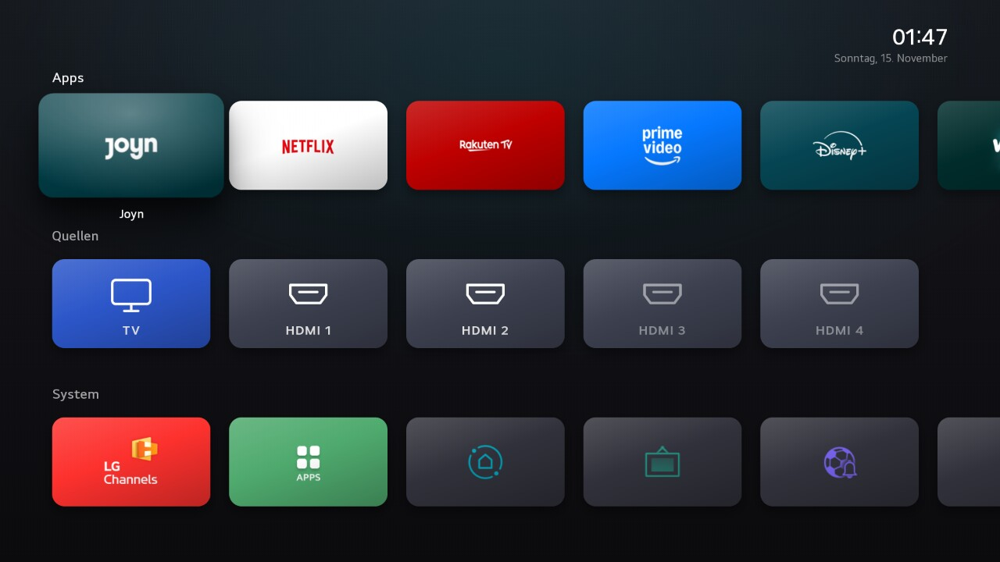

# Custom Launcher für webOS

Ein eigener Startbildschirm im Apple-TV-Stil für **gerootete LG-webOS-TVs** mit [Homebrew Channel](https://github.com/webosbrew/webos-homebrew-channel).

*An Apple-TV-style home screen for rooted LG webOS TVs: dark background, large rounded tiles in horizontal rows, focus zoom with parallax tilt and shadow, D-pad and Magic Remote navigation, optional autostart on boot.*



## Funktionen

- **Apps**: alle installierten Apps aus `luna://com.webos.applicationManager/listLaunchPoints`, mit Original-Icons; die Kachelfarbe wird an den Icon-Hintergrund angeglichen.
- **Quellen**: Live TV und HDMI 1–4 (Namen und Anschluss-Status kommen vom TV); Umschalten über die HDMI-Apps (`com.webos.app.hdmi1` … `hdmi4`).
- **Fokus-Effekt**: Kachel skaliert, kippt beim Navigieren in Bewegungsrichtung (mit der Magic Remote folgt sie dem Zeiger), Glanzlicht und tiefer Schatten; der Hintergrund nimmt die Farbe der fokussierten Kachel an.
- **Bedienung**: Pfeiltasten, OK, Zurück; Magic Remote mit Zeiger, Klick und Scrollrad.
- **Autostart**: öffnet den Launcher nach dem Booten und nach dem Aufwachen aus dem Standby.
- **Einstellungen** (Kachel am Ende der letzten Reihe): Autostart an/aus, LG „Home Auto Launch“ an/aus, System-Apps ein-/ausblenden.
- Kein Build-Schritt: reines HTML/CSS/JS, IPK ca. 30 kB.

## Voraussetzungen

- LG-TV mit webOS, **gerootet**, Homebrew Channel installiert (getestet auf webOS 6.5.3).
- Der Root-Zugriff wird gebraucht, weil Drittanbieter-Apps weder die App-Liste noch fremde Icons lesen dürfen. Der Launcher nutzt dafür den Dienst `org.webosbrew.hbchannel.service/exec` des Homebrew Channel.

## Installation

IPK aus den [Releases](https://github.com/swenz/webos-custom-launcher/releases) laden: `io.github.swenz.customlauncher_1.0.0_all.ipk`.

**Variante A – webOS Dev Manager** ([Download](https://github.com/webosbrew/dev-manager-desktop)): TV verbinden, *Apps → Install* und die IPK auswählen.

**Variante B – webOS CLI** (`npm i -g @webos-tools/cli`, TV einmalig mit `ares-setup-device` einrichten):

```bash
ares-install -d <gerät> io.github.swenz.customlauncher_1.0.0_all.ipk
```

**Variante C – direkt auf dem TV** (SSH oder Telnet als root):

```bash
cd /tmp && wget -O cl.ipk https://github.com/swenz/webos-custom-launcher/releases/download/v1.0.0/io.github.swenz.customlauncher_1.0.0_all.ipk
luna-send -i -f luna://com.webos.appInstallService/dev/install '{"id":"io.github.swenz.customlauncher","ipkUrl":"/tmp/cl.ipk","subscribe":true}'
```

(Mit Strg+C beenden, sobald `"state": "installed"` erscheint.)

## Autostart und „Home Auto Launch“

1. Launcher öffnen, ganz unten rechts **Launcher-Einstellungen** wählen.
2. **Autostart → An**. Dabei wird `autostart.sh` nach `/var/lib/webosbrew/init.d/50-customlauncher` kopiert. Das Startskript des Homebrew Channel führt diese Datei bei jedem Boot aus; ein kleiner Hintergrundprozess startet den Launcher, sobald die TV-Oberfläche bereit ist, und erneut bei jedem Aufwachen aus dem Standby.
3. **LG Home Auto Launch → Aus**. Entspricht *Einstellungen → Allgemein → System → Zusätzliche Einstellungen → Home-Einstellungen → Home Auto Launch*. Bleibt die Option an, öffnet der TV beim Einschalten zusätzlich das LG-Home und legt es über den Launcher.

Autostart von Hand entfernen:

```bash
/var/lib/webosbrew/init.d/50-customlauncher --stop; rm /var/lib/webosbrew/init.d/50-customlauncher
```

Wird die App deinstalliert, tut das Skript nichts mehr; löschen sollte man es trotzdem.

## Grenzen

- Die **Home-Taste** der Fernbedienung öffnet weiterhin das LG-Home. Der Launcher ersetzt es nicht, er liegt nur davor.
- Aufwachen aus dem Standby wird über `com.webos.service.tvpower` erkannt; getestet ist bisher nur der Kaltstart.
- Der Homebrew-Channel-Dienst verträgt keine parallelen `exec`-Aufrufe. Der Launcher sendet sie deshalb strikt nacheinander.

## Selbst bauen

```bash
npm i -g @webos-tools/cli
npm run build
```

Das erzeugt `dist/io.github.swenz.customlauncher_<version>_all.ipk` und aktualisiert das Manifest. Die Icons erzeugt `npm run icons` (Python mit Pillow).

`tools/tvsh.py <tv-ip> '<befehl>'` führt zum Testen einen Befehl über das Root-Telnet des Homebrew Channel aus.

## webosbrew-Manifest

[`io.github.swenz.customlauncher.manifest.json`](io.github.swenz.customlauncher.manifest.json):

```json
{
  "id": "io.github.swenz.customlauncher",
  "version": "1.0.0",
  "type": "web",
  "title": "Custom Launcher",
  "appDescription": "Apple-TV-style home screen for rooted LG webOS TVs",
  "iconUri": "https://github.com/swenz/webos-custom-launcher/raw/main/app/largeIcon.png",
  "sourceUrl": "https://github.com/swenz/webos-custom-launcher",
  "rootRequired": true,
  "ipkUrl": "https://github.com/swenz/webos-custom-launcher/releases/download/v1.0.0/io.github.swenz.customlauncher_1.0.0_all.ipk",
  "ipkHash": {
    "sha256": "ed9888c19ffd14ef5398065d05458a129e6c35494ca2a145c0b1f9f0ba21c6a9"
  }
}
```

## Lizenz

[MIT](LICENSE). Kein offizielles Produkt von LG oder Apple; App-Namen und Icons gehören ihren jeweiligen Inhabern.
